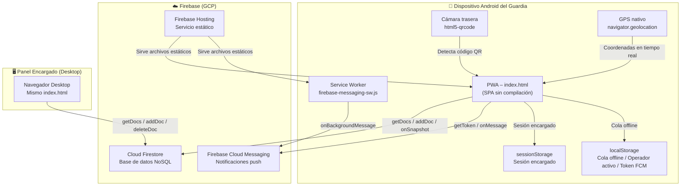
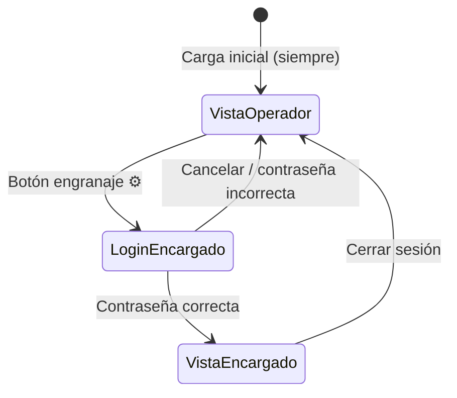
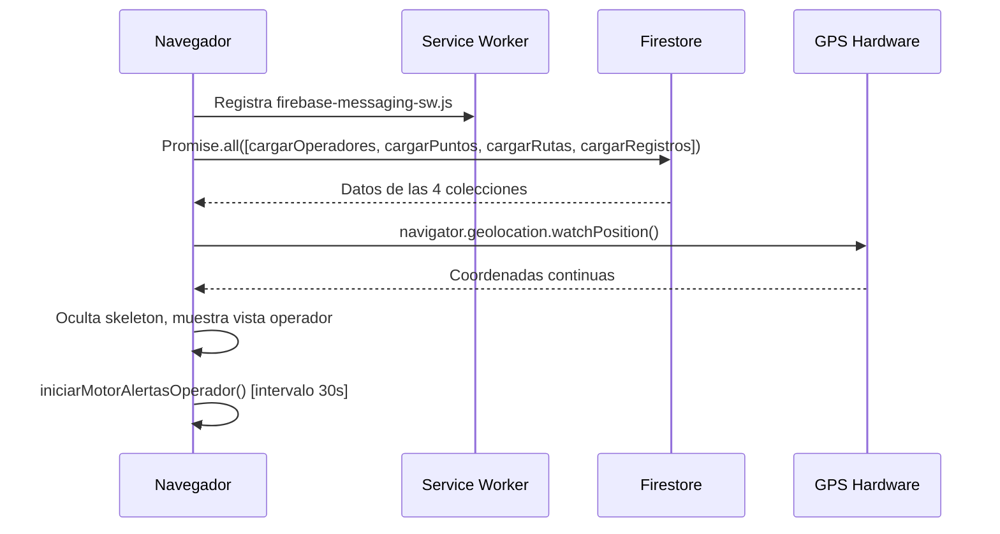
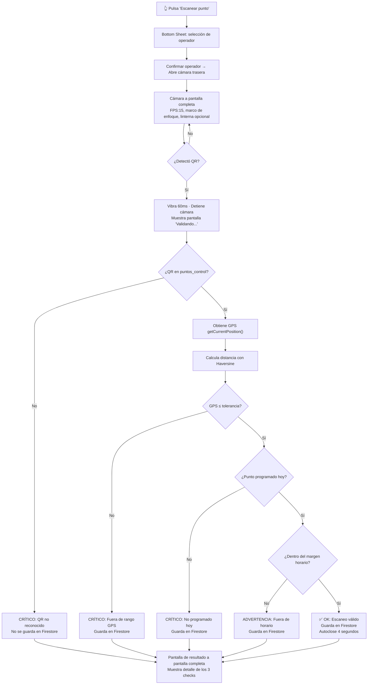
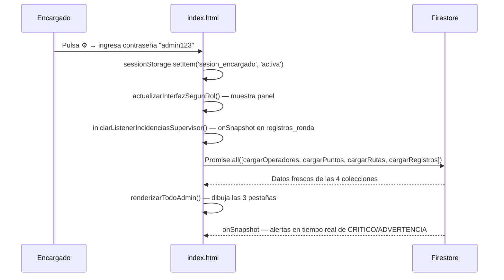
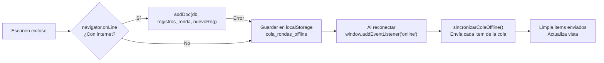
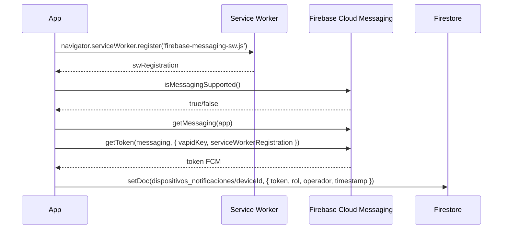

# 📋 Documentación Técnica y Funcional
## Control de Rondas – Meatex
**Versión actual · Noviembre 2026**

---

## Tabla de Contenidos

1. [Visión General del Proyecto](#1-visión-general-del-proyecto)
2. [Problema que resuelve](#2-problema-que-resuelve)
3. [Arquitectura del Sistema](#3-arquitectura-del-sistema)
4. [Stack Tecnológico](#4-stack-tecnológico)
5. [Estructura de Archivos](#5-estructura-de-archivos)
6. [Modelo de Datos (Firestore)](#6-modelo-de-datos-firestore)
7. [Roles y Vistas de Usuario](#7-roles-y-vistas-de-usuario)
8. [Flujos Funcionales Detallados](#8-flujos-funcionales-detallados)
9. [Sistema de Triple Validación](#9-sistema-de-triple-validación)
10. [Motor de Alertas y Notificaciones Push](#10-motor-de-alertas-y-notificaciones-push)
11. [Resiliencia Offline](#11-resiliencia-offline)
12. [Panel del Encargado / Supervisor](#12-panel-del-encargado--supervisor)
13. [PWA e Instalación Android](#13-pwa-e-instalación-android)
14. [Sistema de Notificaciones FCM](#14-sistema-de-notificaciones-fcm)
15. [Paleta Visual y Diseño](#15-paleta-visual-y-diseño)
16. [Variables Globales y Caches](#16-variables-globales-y-caches)
17. [Funciones Clave del Sistema](#17-funciones-clave-del-sistema)
18. [Despliegue e Infraestructura](#18-despliegue-e-infraestructura)
19. [Restricciones y Decisiones de Diseño](#19-restricciones-y-decisiones-de-diseño)
20. [Historial de Cambios](#20-historial-de-cambios)
21. [Estado Actual del Código (18/11/2026)](#21-estado-actual-del-código-18112026)

---

## 1. Visión General del Proyecto

**Control de Rondas – Meatex** es una aplicación web progresiva (PWA/SPA) diseñada para **digitalizar, auditar y verificar en tiempo real** el cumplimiento de los recorridos de vigilancia física de personal de seguridad (guardias/operadores) en instalaciones industriales o comerciales de la empresa Meatex.

### Características principales

| Característica | Detalle |
|---|---|
| Tipo de aplicación | PWA / SPA (Progressive Web App / Single Page Application) |
| Arquitectura | Monolítica, un único archivo HTML sin proceso de compilación (build-less) |
| Hosting | Firebase Hosting (proyecto `control-rondas-porteria-7ecc7`) |
| Backend | Firebase Firestore (NoSQL en la nube) |
| Acceso móvil | Instalable como acceso directo en Android (modo `standalone`) |
| Validación de ronda | Triple: QR + GPS + Horario simultáneos |
| Conectividad | Funciona offline con sincronización automática al reconectar |
| Notificaciones | Nativas Android vía FCM + Service Worker |

---

## 2. Problema que Resuelve

### Problemas del sistema anterior (papel/verbal)

```
❌ Falta de trazabilidad confiable
   → Los registros en papel permiten falsificaciones, omisiones o recorridos
     fuera de horario sin detección inmediata.

❌ Suplantación o escaneo remoto de QR
   → Un código QR físico pegado en un puesto puede ser fotografiado y
     escaneado a distancia si no existe validación geográfica.

❌ Descontrol de horarios
   → Necesidad de garantizar que puntos críticos se recorran en ventanas
     horarias específicas según el día, con márgenes de tolerancia configurables.

❌ Conectividad intermitente en planta/perímetro
   → Zonas sin cobertura Wi-Fi o datos donde el guardia igual debe registrar
     su paso sin perder el dato.
```

### Solución implementada

**Sistema de triple validación simultánea** por cada punto de control:

1. **Identidad física** — Lectura óptica en vivo mediante cámara de un código QR único asignado al punto.
2. **Geolocalización (Geocerca/Geofencing)** — Cálculo de distancia mediante fórmula de Haversine entre las coordenadas GPS del dispositivo del guardia y las coordenadas del punto, exigiendo estar dentro de un radio configurable (por defecto 25 m).
3. **Ventana temporal** — Verificación de que el punto esté programado para el día de la semana actual y que la hora caiga dentro de la hora objetivo ± el margen de tolerancia en minutos.

---

## 3. Arquitectura del Sistema



### Principio de diseño

La aplicación es **completamente estática**: no hay servidor de aplicación, no hay APIs propias, no hay proceso de compilación. Todo el código JavaScript se ejecuta en el navegador del cliente y se comunica directamente con Firebase Firestore vía SDK de Google.

---

## 4. Stack Tecnológico

### Frontend

| Tecnología | Versión | Uso |
|---|---|---|
| HTML5 | — | Estructura de la SPA |
| Tailwind CSS | CDN `cdn.tailwindcss.com` | Estilos utilitarios, responsive |
| IBM Plex Sans | Google Fonts | Tipografía de interfaz |
| IBM Plex Mono | Google Fonts | Coordenadas, horas, códigos, distancias |
| Font Awesome | 6.5.1 vía CDN | Iconografía |

### Librerías JavaScript (vía CDN)

| Librería | Versión | Propósito |
|---|---|---|
| `html5-qrcode` | v2.3.8 | Escaneo QR en vivo mediante cámara |
| `qrcode-generator` | v1.4.4 | Generación y descarga de QR en PNG |

### Backend as a Service

| Servicio | Versión SDK | Funciones utilizadas |
|---|---|---|
| Firebase App | v10.12.2 | `initializeApp` |
| Firebase Firestore | v10.12.2 | `getFirestore`, `collection`, `addDoc`, `setDoc`, `getDocs`, `deleteDoc`, `doc`, `query`, `orderBy`, `limit`, `onSnapshot` |
| Firebase Messaging | v10.12.2 | `getMessaging`, `getToken`, `onMessage`, `isSupported` |

### Service Worker

| Archivo | Librerías (compat) | Propósito |
|---|---|---|
| `firebase-messaging-sw.js` | `firebase-app-compat.js` v10.12.2, `firebase-messaging-compat.js` v10.12.2 | Notificaciones en segundo plano, `notificationclick` |

> [!IMPORTANT]
> El Service Worker debe usar las versiones **compat** (no modular) de Firebase porque los `importScripts()` del scope de SW no soportan `import` ES modules.

---

## 5. Estructura de Archivos

```
RONDAPORTERIA/
├── public/
│   ├── index.html              ← SPA completa (~3093 líneas, ~184 KB)
│   ├── firebase-messaging-sw.js ← Service Worker para FCM y notificaciones
│   ├── manifest.json           ← PWA manifest (nombre, iconos, orientación)
│   ├── icon-192.png            ← Icono PWA 192×192 px
│   ├── icon-512.png            ← Icono PWA 512×512 px
│   ├── badge-72.png            ← Badge para notificaciones Android 72×72 px
│   └── 404.html                ← Página de error 404
├── firebase.json               ← Configuración de Firebase Hosting
└── .firebaserc                 ← Proyecto Firebase activo
```

### Proyecto Firebase

| Campo | Valor |
|---|---|
| Project ID | `control-rondas-porteria-7ecc7` |
| Auth Domain | `control-rondas-porteria-7ecc7.firebaseapp.com` |
| Storage Bucket | `control-rondas-porteria-7ecc7.firebasestorage.app` |
| Sender ID | `873679139344` |
| App ID | `1:873679139344:web:cdf54b69a8eb7582959095` |

---

## 6. Modelo de Datos (Firestore)

La base de datos NoSQL se estructura en **5 colecciones**:

### 6.1 `puntos_control`
Define los puestos físicos donde se colocan los códigos QR impresos.

| Campo | Tipo | Descripción |
|---|---|---|
| `codigo` | `string` | Identificador único del QR (ej. `QR-A1B2C3`). Es la clave primaria de búsqueda. |
| `nombre` | `string` | Nombre descriptivo (ej. `"Portón Principal"`) |
| `lat` | `number` | Latitud geográfica exacta (5 decimales) |
| `lng` | `number` | Longitud geográfica exacta (5 decimales) |
| `tolerancia` | `number` | Radio máximo permitido en metros (default `25`, rango 10–100 m) |

### 6.2 `rutas_horarias`
Define la agenda semanal de recorridos obligatorios.

| Campo | Tipo | Descripción |
|---|---|---|
| `dia` | `string` | Día de la semana (`"Lunes"`, ..., `"Domingo"`) o `"Todos"` para todos los días |
| `codigoQR` | `string` | Referencia al `codigo` de `puntos_control` |
| `puntoNombre` | `string` | Nombre desnormalizado del punto (para renderizado sin joins) |
| `hora` | `string` | Hora objetivo en formato 24h `"HH:MM"` (ej. `"14:30"`) |
| `margen` | `number` | Tolerancia en minutos antes/después de la hora (ej. `5`, `10`, `15`, `30`) |

### 6.3 `operadores`
Padrón del personal de vigilancia habilitado.

| Campo | Tipo | Descripción |
|---|---|---|
| `nombre` | `string` | Nombre y apellido del guardia |
| `legajo` | `string` | Número de legajo interno |
| `turno` | `string` | `"Mañana"`, `"Tarde"` o `"Noche"` |
| `activo` | `boolean` | Controla si aparece disponible en la vista móvil |

### 6.4 `registros_ronda`
Historial **inmutable** de cada escaneo realizado (trazabilidad de auditoría).

| Campo | Tipo | Descripción |
|---|---|---|
| `operador` | `string` | Nombre del guardia que ejecutó el escaneo |
| `puntoNombre` | `string` | Nombre del punto (o `"QR no reconocido"`) |
| `codigoQR` | `string` | Cadena leída por la cámara |
| `fechaTexto` | `string` | Fecha y hora legible `DD/MM/YYYY HH:MM` |
| `fechaISO` | `string` | Fecha normalizada `YYYY-MM-DD` (para filtrado diario) |
| `timestampMs` | `number` | Marca de tiempo Unix en ms (para ordenamiento y cálculos) |
| `horarioProgramado` | `string` | Hora objetivo coincidente o `"Sin agenda"` |
| `latReal` | `number` | Latitud GPS real del guardia al momento del escaneo |
| `lngReal` | `number` | Longitud GPS real del guardia al momento del escaneo |
| `distancia` / `gpsDist` | `number` | Distancia calculada en metros entre punto y guardia |
| `estado` | `string` | Descripción textual: `"Válido"`, `"Fuera de horario"`, `"Fuera de rango GPS"`, `"QR no programado hoy"` |
| `severidad` | `string` | Clasificación de negocio: `"OK"`, `"ADVERTENCIA"` o `"CRITICO"` |

### 6.5 `dispositivos_notificaciones`
Registro de tokens FCM por dispositivo/operador (nueva colección).

| Campo | Tipo | Descripción |
|---|---|---|
| `token` | `string` | Token FCM del dispositivo |
| `rol` | `string` | `"operador"` o `"encargado"` |
| `operador` | `string` | Nombre del operador activo (si rol es operador) |
| `timestamp` | `number` | Marca de tiempo del último registro del token |

> [!NOTE]
> `registros_ronda` es de escritura pero nunca se borra desde la app. Es el registro de auditoría permanente. `puntos_control` y `rutas_horarias` sí se pueden eliminar desde el panel del encargado.

---

## 7. Roles y Vistas de Usuario

La aplicación tiene **dos vistas completamente distintas** dentro del mismo `index.html`, alternables mediante autenticación de supervisión.



### Vista del Operador / Guardia
- **Diseño:** Mobile-first, máx. 480 px, optimizado para uso con una sola mano en campo.
- **Acceso:** Sin autenticación. El operador se selecciona de la lista de operadores activos.
- **Persistencia:** El operador seleccionado se guarda en `localStorage('operador_seleccionado')`.

### Vista del Encargado / Supervisor
- **Diseño:** Desktop & responsive, máx. 1320 px.
- **Acceso:** Contraseña `admin123` guardada en `sessionStorage('sesion_encargado')`.
- **Al cerrar el navegador:** La sesión se cierra automáticamente (sessionStorage no persiste entre pestañas cerradas).

---

## 8. Flujos Funcionales Detallados

### 8.1 Flujo de inicio de la aplicación



### 8.2 Flujo del Guardia — Escaneo de punto



### 8.3 Flujo del Encargado — Login y carga del panel



---

## 9. Sistema de Triple Validación

Cada escaneo ejecuta **3 validaciones en secuencia**. La pantalla de "Validando..." muestra en tiempo real qué pasos se van completando.

### 9.1 Validación 1 — Lectura QR

```js
const punto = puntosCache[codigoLeido];
if (!punto) {
    // CRÍTICO — QR no reconocido
    // No se guarda en Firestore (el código no pertenece al sistema)
}
```

La clave de búsqueda es el texto exacto del QR (`codigo` en `puntos_control`). Formato: `QR-XXXXXX` (6 caracteres alfanuméricos mayúsculos aleatorios generados al crear el punto).

### 9.2 Validación 2 — Geofencing (Haversine)

```js
function calcularDistanciaMetros(lat1, lon1, lat2, lon2) {
    const R = 6371e3, rad = Math.PI / 180;
    const dLat = (lat2 - lat1) * rad, dLon = (lon2 - lon1) * rad;
    const a = Math.sin(dLat / 2) ** 2 +
              Math.cos(lat1 * rad) * Math.cos(lat2 * rad) * Math.sin(dLon / 2) ** 2;
    return Math.round(R * 2 * Math.atan2(Math.sqrt(a), Math.sqrt(1 - a)));
}
// gpsValido = distancia <= punto.tolerancia (en metros)
```

La distancia se calcula entre `(punto.lat, punto.lng)` almacenado en Firestore y `(pos.coords.latitude, pos.coords.longitude)` obtenido en el momento del escaneo con `enableHighAccuracy: true`.

### 9.3 Validación 3 — Ventana Horaria

```
Para cada ruta del punto en rutas_horarias (filtrado por día):
  - Calcula diff = |ahora - horaObjetivo| en minutos
  - Si diff <= margen → horario válido
  - Si diff > margen → ADVERTENCIA (fuera de horario)
  - Si no hay rutas para hoy → CRÍTICO (no programado)
```

Cuando un punto tiene múltiples horarios el mismo día, se selecciona automáticamente el más cercano en el tiempo.

### Tabla de resultados combinados

| GPS | Horario | Programado | Severidad | Estado |
|---|---|---|---|---|
| ✅ | ✅ | ✅ | `OK` | Válido |
| ✅ | ❌ | ✅ | `ADVERTENCIA` | Fuera de horario |
| ❌ | — | ✅ | `CRITICO` | Fuera de rango GPS |
| — | — | ❌ | `CRITICO` | QR no programado hoy |
| QR inválido | — | — | `CRITICO` | QR no reconocido (no se guarda) |

---

## 10. Motor de Alertas y Notificaciones Push

### 10.1 Motor del operador (`iniciarMotorAlertasOperador`)

Se ejecuta cada **30 segundos** mediante `setInterval`. Analiza el estado actual de la agenda del día y emite notificaciones **consolidadas** (una sola por categoría, aunque haya múltiples puntos).

#### Las 3 alertas configuradas

| # | Nombre | Condición de disparo | Tag Android |
|---|---|---|---|
| 1 | **Punto próximo** | Faltan entre 4 y 6 minutos para la hora objetivo | `motor-previo5min` |
| 2 | **Ventana por vencer** | Quedan entre 0 y 3 minutos para que venza el margen de un punto pendiente | `motor-vence3min` |
| 3 | **Incumplimiento** | El margen venció y el punto sigue sin escanearse | `motor-incumplido` |

#### Lógica anti-repetición

```js
function debeEmitirAlerta(clave, intervaloMs) {
    const ahora = Date.now();
    const ultima = historialAlertasOperador[clave] || 0;
    if (ahora - ultima < intervaloMs) return false;
    historialAlertasOperador[clave] = ahora;
    return true;
}
```
- Alerta 1 (previo 5 min): intervalo 4 min entre disparos.
- Alerta 2 (vence 3 min): intervalo 2 min entre disparos.
- Alerta 3 (incumplimiento): intervalo 10 min entre disparos.

#### Consolidación de múltiples puntos

Si hay 3 puntos próximos a vencer simultáneamente, se emite **una sola notificación**:
> "⏰ 3 puntos por vencer — Revisá tu agenda ahora."

Nunca se emiten 3 notificaciones individuales.

### 10.2 Listener del encargado (`iniciarListenerIncidenciasSupervisor`)

Usa `onSnapshot` de Firestore para escuchar en **tiempo real** los nuevos registros de la colección `registros_ronda`. Cuando llega un nuevo registro con `severidad: "CRITICO"` o `"ADVERTENCIA"`, el supervisor recibe una notificación de inmediato.

```js
onSnapshot(query(collection(db, "registros_ronda"), orderBy("timestampMs", "desc"), limit(1)),
    (snap) => {
        snap.docChanges().forEach(change => {
            if (change.type === "added") {
                const r = change.doc.data();
                if (r.severidad === "CRITICO" || r.severidad === "ADVERTENCIA") {
                    lanzarNotificacionSistema(...);
                }
            }
        });
    }
);
```

### 10.3 Función `lanzarNotificacionSistema`

Maneja **3 canales** en orden de preferencia:

```
1. swRegistration.showNotification()  → Android Chrome (canal principal)
   - Requiere Service Worker registrado
   - Soportado en segundo plano

2. new Notification()  → Fallback para navegadores desktop

3. Banner in-app  → Siempre visible en la propia pantalla de la app
   - Aparece en la parte superior
   - Se auto-oculta tras 5 segundos
```

> [!IMPORTANT]
> `new Notification()` está **bloqueado** en Android Chrome. Por eso siempre se usa primero `swRegistration.showNotification()`. Este es un requisito crítico para que las notificaciones funcionen en el dispositivo del guardia.

---

## 11. Resiliencia Offline

Cuando el guardia escanea un punto sin conexión a internet (o si Firestore falla):



### Clave de localStorage utilizada

| Clave | Valor | Propósito |
|---|---|---|
| `cola_rondas_offline` | `JSON.stringify(array)` | Cola de registros pendientes de sincronizar |
| `operador_seleccionado` | `string` | Nombre del guardia activo (persiste entre sesiones) |
| `fcm_token_guardado` | `string` | Token FCM del dispositivo |

---

## 12. Panel del Encargado / Supervisor

### Pestañas disponibles

#### Tab 1 — Auditoría
- Tabla de los últimos 250 registros de `registros_ronda` ordenados por `timestampMs` descendente.
- **Filtros:** Por operador (select), por estado/severidad, por rango de fechas (`offsetDiasFiltro`).
- **KPIs en tiempo real:** Total de escaneos del día, % de cumplimiento, incidencias CRITICO/ADVERTENCIA.
- **Resúmenes:** Conteo de OK, ADVERTENCIA y CRITICO en chips visuales.

#### Tab 2 — Puntos y Horarios (Rutas)
- **Tabla de puntos:** Lista todos los `puntos_control` con sus coordenadas GPS, radio de tolerancia, días y horarios agendados.
- **Formulario nuevo punto:** Permite crear un punto usando el GPS actual del dispositivo o ingresando coordenadas manualmente.
- **Agenda de rutas:** Lista de `rutas_horarias` filtrable por día de la semana.
- **Formulario nueva ruta:** Selector de punto, días de la semana (chips toggleables), hora objetivo, margen de tolerancia.
- **Generación de QR:** Botón "QR" en cada punto que genera y permite descargar el PNG para imprimir.

#### Tab 3 — Personal
- Tabla de `operadores` con nombre, legajo, turno, último escaneo.
- **Formulario alta de operador:** Nombre, legajo, turno (Mañana/Tarde/Noche), estado activo.
- **Eliminar operador:** Con confirmación.
- **Badge en tab:** Muestra el total de operadores registrados.

### Actualización de datos

El botón "Actualizar" (ícono de refresh) llama a `actualizarDatosPanel()`:
```js
await Promise.all([cargarOperadores(), cargarPuntos(), cargarRutas(), cargarRegistrosRecientes()]);
renderizarTodoAdmin();
```

---

## 13. PWA e Instalación Android

### Configuración del manifest (`manifest.json`)

```json
{
  "name": "Control de Rondas – Meatex",
  "short_name": "Rondas Meatex",
  "description": "Sistema de Digitalización y Auditoría en Tiempo Real de Rondas de Seguridad",
  "start_url": "./",
  "display": "standalone",
  "orientation": "portrait-primary",
  "background_color": "#F7F7F5",
  "theme_color": "#0F172A",
  "icons": [
    { "src": "icon-192.png", "sizes": "192x192", "type": "image/png", "purpose": "any maskable" },
    { "src": "icon-512.png", "sizes": "512x512", "type": "image/png", "purpose": "any maskable" }
  ]
}
```

### Comportamiento en Android

| Característica | Valor |
|---|---|
| Modo display | `standalone` (sin barra del navegador) |
| Orientación | `portrait-primary` (bloqueada en vertical) |
| Color de barra de estado | `#0F172A` (Slate oscuro) |
| Icono en pantalla inicio | `icon-192.png` y `icon-512.png` |
| Badge en notificaciones | `badge-72.png` (72×72 px) |
| Vibración en escaneo | `navigator.vibrate(60)` al detectar QR |
| Vibración en error CRITICO | `navigator.vibrate([80, 60, 80])` |

### Permisos requeridos en Android

| Permiso | API | Para qué se usa |
|---|---|---|
| Cámara | `getUserMedia` vía `html5-qrcode` | Escaneo QR |
| Ubicación | `navigator.geolocation` | Validación geofencing |
| Notificaciones | `Notification.requestPermission()` | Alertas preventivas |

---

## 14. Sistema de Notificaciones FCM

### Flujo de registro de token



### Notificaciones en primer plano vs segundo plano

| Contexto | Manejador | Canal |
|---|---|---|
| App abierta y visible | `onMessage(messaging, handler)` en `index.html` | Banner in-app + vibración |
| App en segundo plano / cerrada | `messaging.onBackgroundMessage()` en SW | Notificación nativa Android |
| Mensaje desde la app al SW | `swRegistration.postMessage({ type: 'SHOW_NATIVE_NOTIFICATION' })` | Notificación nativa Android |

> [!WARNING]
> Para que las notificaciones push en segundo plano funcionen, se requiere configurar un **VAPID key** desde Firebase Console → Project Settings → Cloud Messaging → Web Push certificates. Sin este key, `getToken()` falla silenciosamente y no se recibirán pushes cuando la app esté cerrada.

---

## 15. Paleta Visual y Diseño

### Colores del sistema

| Nombre | Hex | Uso |
|---|---|---|
| Slate oscuro | `#0F172A` | Fondo de header operador, card "Próximo punto", botones principales |
| Fondo neutro | `#F7F7F5` | Fondo general de la app |
| Gris claro | `#F1F5F9` / `#E2E8F0` | Fondos de cards, bordes, separadores |
| Texto principal | `#334155` | Texto general |
| Texto secundario | `#64748B` / `#94A3B8` | Texto de apoyo, timestamps, etiquetas |
| Verde éxito | `#059669` | Estado OK, GPS activo, escaneo válido |
| Ámbar advertencia | `#D97706` | Estado ADVERTENCIA, fuera de horario |
| Rojo crítico | `#DC2626` | Estado CRITICO, errores, GPS sin señal |

### Tipografía

| Familia | Uso | Clase CSS custom |
|---|---|---|
| IBM Plex Sans | Todo el texto de interfaz | (default) |
| IBM Plex Mono | Coordenadas GPS, horas, códigos QR, distancias en metros | `font-mono-val` |

### Pastillas de estado (Pills) en header del operador

```
GPS ±6m  → Verde  = GPS activo con precisión
GPS…     → Ámbar  = Buscando señal GPS
Sin GPS  → Rojo   = Sin acceso a GPS

🔔 Activo  → Verde  = Notificaciones permitidas
🔕 Silencio → Ámbar = Notificaciones denegadas
🔔 —       → Rojo  = No soportado
```

---

## 16. Variables Globales y Caches

```js
// Sesión y estado
let operadorActivo = ""         // Nombre del guardia actualmente seleccionado
let operadorPreseleccionadoSheet = ""  // Preselección en el bottom sheet
let html5QrCode = null          // Instancia del lector QR
let linternaActiva = false      // Estado de la linterna

// GPS
let ultimaPrecisionGPS = null   // Última precisión GPS en metros

// Caches de datos (cargados desde Firestore)
let puntosCache = {}            // Indexado por código QR { "QR-ABC": { ... } }
let rutasCache = []             // Array de rutas_horarias
let registrosCache = []         // Array de los últimos 250 registros
let operadoresCache = []        // Array de operadores

// Estado del UI
let diasSeleccionadosForm = []  // Días seleccionados en form de nueva ruta
let turnoOpSeleccionado = "Mañana"
let filtroEstadoActual = "todos"
let offsetDiasFiltro = 0        // 0 = hoy, -1 = ayer, etc.
let timerAutocierreAlerta = null

// FCM y notificaciones
let swRegistration = null       // Referencia al Service Worker registrado
let fcmMessaging = null         // Instancia de Firebase Messaging
let unsubscribeIncidenciasSupervisor = null  // Función para cancelar onSnapshot
let fcmTokenActual = null       // Token FCM actual del dispositivo
let historialAlertasOperador = {}  // Anti-repetición de alertas { clave: timestampMs }

// Constantes
const DIAS_SEMANA = ["Domingo", "Lunes", "Martes", "Miércoles", "Jueves", "Viernes", "Sábado"];
const PASSWORD_ENCARGADO = "admin123";
```

---

## 17. Funciones Clave del Sistema

### Inicialización

| Función | Qué hace |
|---|---|
| `DOMContentLoaded` async | Registra SW, carga todos los datos de Firestore, inicia GPS, arranca motor de alertas |
| `inicializarServiceWorkerYNotificaciones()` | Registra el SW, inicializa FCM, configura `onMessage` para primer plano |
| `iniciarMonitorGPSHeader()` | Inicia `watchPosition` continuo para mantener el GPS caliente |
| `sincronizarColaOffline()` | Envía a Firestore todos los registros guardados en `cola_rondas_offline` |

### Datos

| Función | Colección | Tipo |
|---|---|---|
| `cargarOperadores()` | `operadores` | async, `getDocs` |
| `cargarPuntos()` | `puntos_control` | async, `getDocs` |
| `cargarRutas()` | `rutas_horarias` | async, `getDocs` |
| `cargarRegistrosRecientes()` | `registros_ronda` | async, `getDocs`, limit 250, orderBy `timestampMs` desc |

### Vista Operador

| Función | Qué renderiza |
|---|---|
| `refrescarVistaOperador()` | Llama a las 3 funciones de render del operador |
| `evaluarEstadoRutasHoy()` | Calcula el estado (completado/vencido/próximo/pendiente) de cada ruta del día |
| `renderizarProgresoYProximoOperador()` | Barra de progreso y card "Próximo punto" |
| `renderizarAgendaOperador()` | Lista de agenda del día con estado visual |
| `renderizarRecientesOperador()` | Últimos 6 escaneos del cache |

### Vista Encargado

| Función | Qué renderiza |
|---|---|
| `renderizarTodoAdmin()` | Llama a las 5 funciones de render admin |
| `renderizarTablaAuditoria()` | Tabla de registros con filtros |
| `renderizarKPIs()` | Tarjetas de métricas en el header del panel |
| `renderizarPuntosAdmin()` | Tabla de puntos de control |
| `renderizarRutasAdmin()` | Lista de horarios agendados |
| `renderizarPersonalAdmin()` | Tabla de operadores |
| `actualizarDatosPanel()` | Recarga datos + renderiza todo (botón refresh) |

### Escaneo y Validación

| Función | Qué hace |
|---|---|
| `iniciarCamara()` | Abre la cámara trasera con `html5-qrcode` |
| `onScanSuccess(codigoLeido)` | Orquesta la triple validación completa |
| `calcularDistanciaMetros()` | Fórmula de Haversine → distancia en metros |
| `mostrarAlertaPantallaCompleta(data)` | Muestra el resultado visual del escaneo |
| `cerrarAlertaResultado()` | Cierra el modal y refresca la vista |

### Notificaciones

| Función | Qué hace |
|---|---|
| `lanzarNotificacionSistema(titulo, texto, severidad, tag)` | async — Banner + SW notification + vibración |
| `debeEmitirAlerta(clave, intervaloMs)` | Anti-repetición de alertas |
| `iniciarMotorAlertasOperador()` | Loop de 30s con 3 tipos de alertas consolidadas |
| `registrarTokenFCM(rol)` | Guarda el token FCM en `dispositivos_notificaciones` |
| `iniciarListenerIncidenciasSupervisor()` | `onSnapshot` en `registros_ronda` para alertas en tiempo real |

---

## 18. Despliegue e Infraestructura

### Firebase Hosting

```
firebase deploy --only hosting
```

Sirve todos los archivos de `/public` como hosting estático con HTTPS automático.

### URLs de acceso

| Entorno | URL |
|---|---|
| Producción | `https://control-rondas-porteria-7ecc7.web.app` |
| Alternativa | `https://control-rondas-porteria-7ecc7.firebaseapp.com` |

### Reglas de Firestore

> [!CAUTION]
> Las reglas de seguridad de Firestore deben estar configuradas en la consola de Firebase para permitir lectura/escritura desde la web. Si están en modo producción restringido, se requieren las reglas adecuadas para el `projectId` configurado.

### Gestión de índices Firestore

La consulta de auditoría usa:
```js
query(collection(db, "registros_ronda"), orderBy("timestampMs", "desc"), limit(250))
```
Esto puede requerir un índice compuesto en Firestore si se agrega un segundo `where`. El índice simple sobre `timestampMs` es automático.

---

## 19. Restricciones y Decisiones de Diseño

### ¿Por qué un único archivo HTML?

| Razón | Detalle |
|---|---|
| **Sin build step** | No requiere Node.js, webpack, Vite ni ninguna herramienta de compilación. Se puede editar y desplegar directamente. |
| **Hosting estático** | Firebase Hosting sirve archivos estáticos. Un único archivo elimina dependencias de rutas y configuración de SPA. |
| **Simplicidad operativa** | El cliente solo necesita un archivo actualizado para tener la última versión. |
| **Restricción del cliente** | Decisión de arquitectura inicial que se mantiene por coherencia y simplicidad. |

### ¿Por qué Tailwind CDN y no instalación local?

Consecuencia directa del enfoque sin build step. Se acepta la restricción de no poder purgar clases no usadas a cambio de zero-config.

### ¿Por qué Firebase y no otro backend?

| Criterio | Firebase |
|---|---|
| SDK web completo | ✅ |
| Tiempo real (onSnapshot) | ✅ |
| Hosting integrado con HTTPS | ✅ |
| Sin servidor propio | ✅ |
| Plan gratuito (Spark) | ✅ suficiente para la escala del proyecto |

### ¿Por qué no Firebase Auth?

La autenticación del guardia es por selección de nombre (sin password) para maximizar la velocidad de uso en campo. El encargado usa una contraseña simple almacenada en el código fuente (`admin123`). No se consideró necesario un sistema de auth completo para este caso de uso.

> [!WARNING]
> La contraseña `admin123` está hardcodeada en el fuente. Para un entorno de producción con mayor sensibilidad, se recomienda migrar a Firebase Authentication con email/password para el encargado.

---

## 20. Historial de Cambios

| Fecha | Cambio |
|---|---|
| Nov 2026 | **Renombrado:** "Advance ERP" → **"Meatex"** en todos los textos, títulos y manifest |
| Nov 2026 | **PWA:** Agregado `manifest.json`, `icon-192.png`, `icon-512.png`, `badge-72.png` |
| Nov 2026 | **Service Worker:** Creado `firebase-messaging-sw.js` con soporte FCM background |
| Nov 2026 | **Notificaciones:** 3 tipos consolidados para el motor del operador |
| Nov 2026 | **Fix responsive:** Pastilla GPS en header operador (letra "m" descolocada) |
| Nov 2026 | **Fix crítico:** Panel del encargado no cargaba datos — `intentarLoginEncargado` ahora es `async` y hace `await Promise.all(cargar*)` antes de renderizar |
| Nov 2026 | **FCM:** Función `registrarTokenFCM()`, listener supervisor en tiempo real, `lanzarNotificacionSistema` usa SW para Android Chrome |
| 18/11/2026 | **Fix panel:** eliminadas referencias a IDs inexistentes en `renderizarKPIs`; el panel ya muestra puntos, rutas y personal sin necesidad de crear un usuario |
| 18/11/2026 | **Rondas:** cada horario programado exige su propio escaneo; un escaneo ya no completa todos los horarios del mismo punto |
| 18/11/2026 | **Retención:** campo `expiraEn` y retención de 60 días mediante TTL de Firestore |
| 18/11/2026 | **Límites:** máximo 20 puntos y 30 operadores, validado en la interfaz |
| 18/11/2026 | **Personal:** activar/desactivar operadores, métricas reales del día y confirmación antes de eliminar |
| 18/11/2026 | **Exportación:** XLSX con detalle, resumen y cumplimiento por operador (últimos 60 días o día seleccionado) |
| 18/11/2026 | **Notificaciones:** eliminado el banner interno; solo se usan notificaciones del sistema |
| 18/11/2026 | **Reglas:** agregada la colección `dispositivos_notificaciones` y archivo `firestore.rules` versionado |

---

## 21. Estado Actual del Código (18/11/2026)

Esta sección describe el comportamiento **real** del código en esta fecha y corrige los puntos de las secciones anteriores que quedaron desactualizados.

### 21.1 Modelo de datos ampliado

`registros_ronda` ahora guarda, además de los campos originales:

| Campo | Tipo | Uso |
|---|---|---|
| `rutaId` | string | ID del documento de `rutas_horarias` que corresponde al escaneo |
| `diaRuta` | string | Día de la ruta aplicada |
| `margen` | number | Margen aplicado en el momento del escaneo |
| `tolerancia` | number | Tolerancia GPS aplicada en el momento del escaneo |
| `creadoEn` | timestamp | Fecha de creación del registro |
| `expiraEn` | timestamp | Fecha de expiración para la política TTL (60 días) |

Esto permite que la auditoría histórica no se reinterpreta con la tolerancia o el margen actuales del punto.

### 21.2 Regla de múltiples horarios

Si un punto tiene varios horarios el mismo día, **cada horario requiere un escaneo propio**. La agenda y el motor de alertas consideran completada una ruta solo si existe un registro `OK` asociado a esa ruta (`rutaId`, o `codigoQR` + `horarioProgramado` para registros antiguos). Un escaneo fuera de horario (`ADVERTENCIA`) o fuera de rango GPS (`CRITICO`) no completa la ruta.

### 21.3 Panel del encargado

- `renderizarTodoAdmin()` ejecuta cada bloque de forma independiente; un error en un bloque ya no oculta los demás.
- Los KPIs, la tabla y los resúmenes usan `registrosAdminCache`, que corresponde al día seleccionado.
- La navegación de fechas vuelve a consultar Firestore para el día elegido.
- La sesión del encargado persiste en `sessionStorage` hasta cerrar la pestaña; al recargar se vuelve a cargar el panel completo.

### 21.4 Alertas y notificaciones

- Se eliminó el banner flotante interno. Solo se emiten notificaciones del sistema (bandeja del teléfono) y vibración asociada a la notificación.
- El motor del operador revisa cada 30 segundos y usa estos intervalos efectivos: 15 minutos para el aviso previo, 10 minutos para el aviso de vencimiento y 60 minutos para el incumplimiento. Los tags efectivos son `ronda-lote-5min`, `ronda-lote-vence-3min` y `ronda-lote-incumplido`.
- El listener del encargado consulta los últimos 5 registros (`limit(5)`) y alerta solo por registros nuevos de la sesión.

### 21.5 Retención, límites y exportación

- Retención: 60 días mediante `expiraEn` + política TTL de Firestore. Los registros antiguos sin `expiraEn` no se eliminan automáticamente.
- Límites: 20 puntos de control y 30 operadores.
- Exportación: `.xlsx` con hojas `Rondas`, `Resumen` y `Por operador`. Si el panel está en el día actual, exporta los últimos 60 días; si se navegó a una fecha anterior, exporta ese día. Aplica los filtros activos.
- El botón de imprimir QR genera una hoja de impresión con todos los QR; la descarga individual se convierte a PNG real.

### 21.6 Operadores

- Se pueden **desactivar** (dejan de aparecer en la vista operador y en el selector) o **eliminar**.
- La tabla de personal muestra escaneos reales del día, porcentaje de válidos y último escaneo; ya no usa valores fijos.
- Las eliminaciones piden confirmación. Al eliminar un punto se eliminan también sus horarios en una operación por lotes.

### 21.7 Pendientes conocidos

| Tema | Estado |
|---|---|
| Contraseña `admin123` hardcodeada | Pendiente: migrar a Firebase Auth |
| Reglas de Firestore abiertas | Pendiente: requieren autenticación para endurecerse |
| Push con app cerrada | Requiere clave VAPID y un emisor de push; el repositorio no incluye el emisor |
| Offline completo | Solo se encolan registros; no hay cache de app shell |
| Registros históricos sin `expiraEn` | Requieren migración o borrado manual |
| Tests de reglas de negocio | Solo existe validación estática (`tests/validar-index.mjs`) |

---

*Documentación generada el 18 de noviembre de 2026 · Control de Rondas – Meatex*

